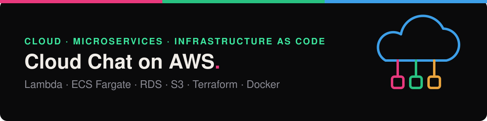
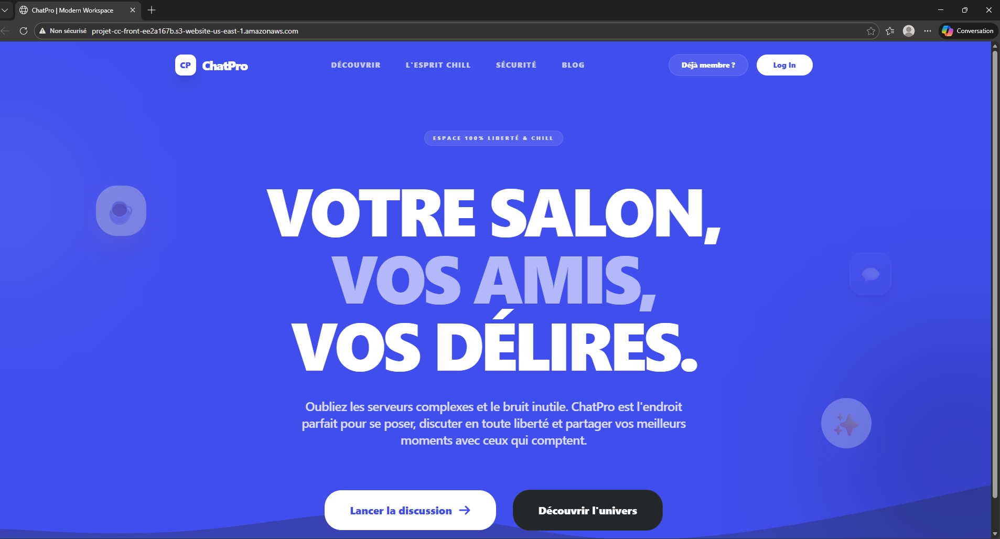
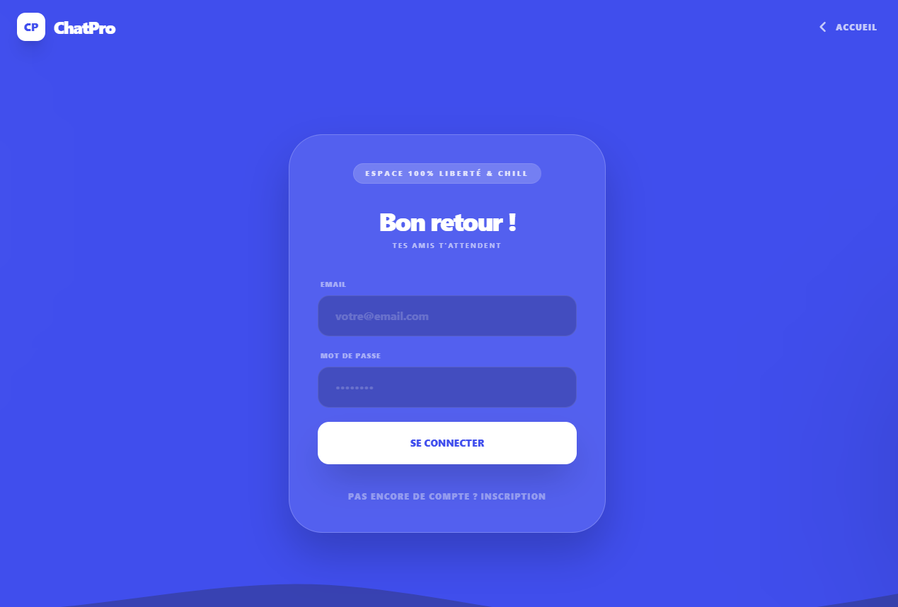
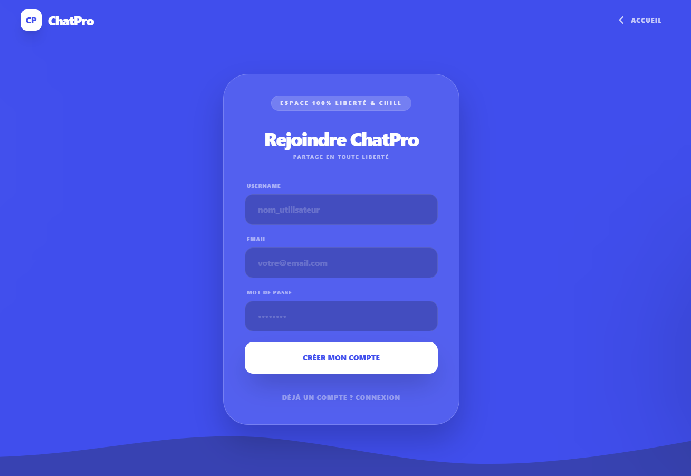
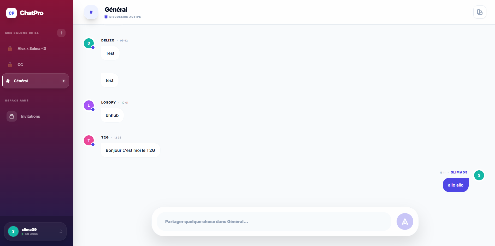
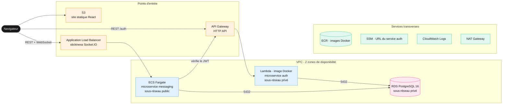
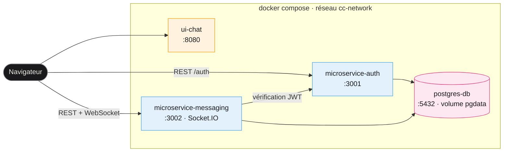
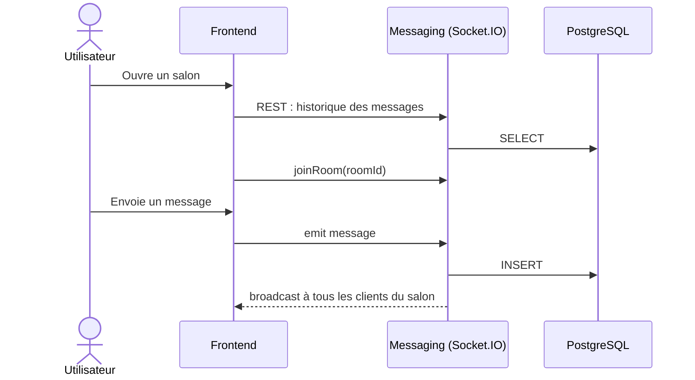
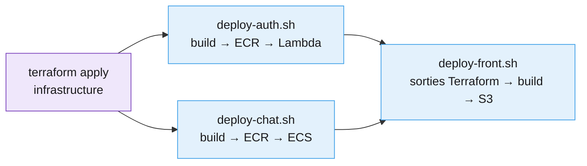
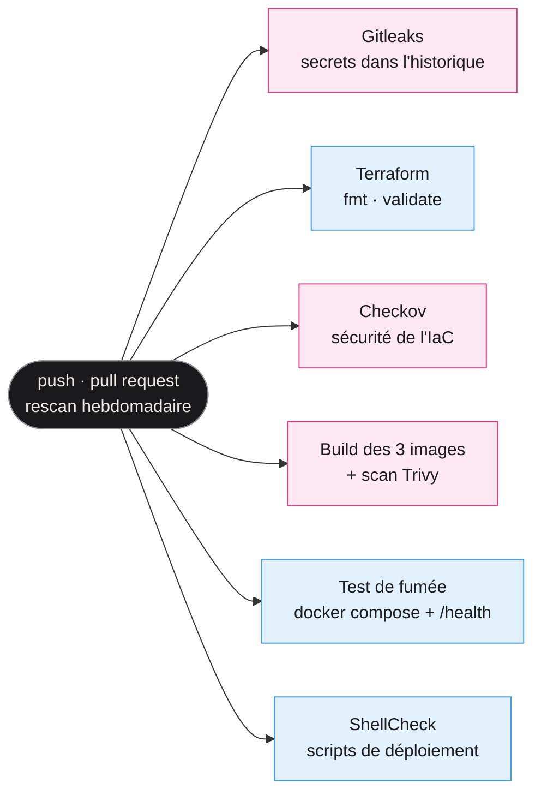

<p align="center">
  
</p>

<p align="center">
  <a href="https://github.com/salma2002ba/cloud-chat-aws/actions/workflows/ci.yml"></a>
  
  
  
  
  
</p>

<p align="center">
  
  
  
  
  
  
  
  
  
  
</p>

# Cloud Chat on AWS

Une application de messagerie en temps réel, découpée en **microservices**, conteneurisée avec
**Docker** et déployée sur **AWS** par **Terraform** : authentification serverless sur Lambda,
messagerie sur ECS Fargate derrière un Load Balancer, base PostgreSQL managée dans un réseau privé,
frontend statique sur S3.

Projet du cours de Cloud Computing, 5e année d'ingénieur informatique, Polytech Marseille
(2025 – 2026).

| | |
|---|---|
| **2** microservices Node.js | **11** services AWS |
| **25** ressources Terraform + un module VPC | **4** images Docker (dont une image Lambda) |
| **2** modes de communication : polling REST et WebSocket | **6** contrôles automatiques à chaque push |

## Sommaire

- [Aperçu](#aperçu)
- [Architecture AWS](#architecture-aws)
- [Architecture locale](#architecture-locale)
- [Temps réel : du polling au WebSocket](#temps-réel--du-polling-au-websocket)
- [Infrastructure as Code](#infrastructure-as-code)
- [Sécurité](#sécurité)
- [Pipeline CI DevSecOps](#pipeline-ci-devsecops)
- [Lancer le projet](#lancer-le-projet)
- [Ce que les scans révèlent et la suite](#ce-que-les-scans-révèlent-et-la-suite)

---

## Aperçu

L'application déployée sur AWS, servie depuis un bucket S3 (l'URL `s3-website-us-east-1` est
visible dans la barre d'adresse) :

<p align="center">
  
</p>

<table>
  <tr>
    <td width="50%"></td>
    <td width="50%"></td>
  </tr>
  <tr>
    <td align="center"><b>Connexion</b> : jeton JWT émis par la Lambda d'authentification</td>
    <td align="center"><b>Inscription</b> : mot de passe haché avec bcrypt</td>
  </tr>
</table>

<p align="center">
  <br>
  <b>Salon de discussion</b> : messages diffusés en temps réel par Socket.IO depuis ECS Fargate
</p>

**Fonctionnalités** : inscription, connexion et changement de mot de passe, salons publics et
privés, invitations, historique et recherche de messages, édition et suppression de messages,
thèmes de salon.

## Architecture AWS



**Pourquoi ces choix**

| Composant | Service AWS | Raison |
|---|---|---|
| Authentification | **Lambda** + API Gateway | Trafic ponctuel (connexion, inscription) : on ne paie qu'à l'exécution, la mise à l'échelle est automatique |
| Messagerie | **ECS Fargate** + ALB | Connexions WebSocket persistantes, incompatibles avec une Lambda. Fargate exécute le conteneur sans gérer de serveur |
| Base de données | **RDS PostgreSQL** | Base managée (sauvegardes, correctifs), placée dans les sous-réseaux privés |
| Frontend | **S3** (site statique) | Hébergement simple, haute disponibilité native |
| Images | **ECR** | Registre privé d'où Lambda et ECS tirent leurs images |
| Configuration | **SSM Parameter Store** | Le service de messagerie découvre l'URL de l'API d'authentification sans valeur en dur |

**Le détail qui compte** : l'ALB active la **stickiness** (cookie de session). Socket.IO commence
par du polling HTTP avant de passer en WebSocket : sans affinité de session, un client pourrait
tomber sur une autre tâche ECS en cours de route.

## Architecture locale

Toute la plateforme démarre en une commande avec Docker Compose. Les microservices attendent que
PostgreSQL soit prêt (`healthcheck` + `depends_on: service_healthy`) et redémarrent en cas d'échec.



## Temps réel : du polling au WebSocket

Le projet implémente les deux modes demandés, pour les comparer.

| | Palier 1 : passif | Palier 2 : actif |
|---|---|---|
| Mécanisme | Le client interroge l'API REST toutes les 4 s (`GET /messages?since=`) | Connexion WebSocket persistante (Socket.IO) |
| Latence | Jusqu'à 4 s | Quasi instantanée |
| Charge | Une requête HTTP par client toutes les 4 s, même sans nouveau message | Un message n'est envoyé que s'il existe |
| Infrastructure | Compatible avec n'importe quel backend HTTP | Demande des connexions longues : d'où ECS Fargate plutôt que Lambda |



Les deux approches se combinent : l'historique arrive par REST, les nouveaux messages par
WebSocket, et tout est persisté en base.

## Infrastructure as Code

Toute l'infrastructure AWS est décrite en Terraform, dans [`terraform/`](terraform/).

| Fichier | Contenu |
|---|---|
| `versions.tf` | Versions de Terraform et des providers, épinglées |
| `variables.tf` | Région, rôle IAM, identifiants de base et secret JWT (marqués `sensitive`) |
| `main.tf` | Provider AWS, rôle IAM, Security Group applicatif, compte courant |
| `lambda.tf` | VPC (module officiel `terraform-aws-modules/vpc`) : 2 AZ, sous-réseaux publics et privés, NAT |
| `auth.tf` | Lambda à partir d'une image ECR, API Gateway HTTP, paramètre SSM |
| `chat.tf` | ECR, cluster ECS, task definition Fargate, service, ALB, Security Groups, logs CloudWatch |
| `database.tf` | RDS PostgreSQL 16, groupe de sous-réseaux privés, Security Group |
| `frontend.tf` | Bucket S3 en site statique, nom unique généré par `random_id` |

Le déploiement suit 4 étapes : **Terraform** crée l'infrastructure, puis trois scripts construisent
et publient chaque composant.



`deploy-front.sh` lit les URL des API et le nom du bucket dans les **sorties Terraform** : aucune
adresse n'est copiée à la main.

## Sécurité

- **Base de données isolée** : RDS est dans les sous-réseaux privés (`publicly_accessible = false`)
  et n'accepte le port 5432 que depuis les Security Groups de la Lambda et des tâches ECS.
- **Chaîne de Security Groups** : Internet → ALB (port 80) → ECS (port 3000, seulement depuis
  l'ALB) → RDS (port 5432, seulement depuis l'application).
- **Aucun secret dans le code** : mot de passe de la base et secret JWT passent par des variables
  Terraform `sensitive` (fichier `terraform.tfvars` ignoré par Git), l'identifiant du compte AWS est
  lu dynamiquement (`aws_caller_identity`, `aws sts get-caller-identity`), et Gitleaks vérifie tout
  l'historique Git à chaque push.
- **Mots de passe hachés** avec bcrypt, sessions par **jetons JWT**, vérifiés par le service de
  messagerie auprès du service d'authentification.
- **Validation des entrées** côté API (`class-validator`).

## Pipeline CI DevSecOps

À chaque push, à chaque pull request et chaque lundi, GitHub Actions lance :



| Contrôle | Outil | Bloquant ? | Ce qu'il vérifie |
|---|---|---|---|
| Secrets | Gitleaks | Oui | Aucun mot de passe, jeton ou clé dans le code ni dans l'historique |
| Infrastructure | Terraform | Oui | Code formaté et configuration valide |
| Sécurité de l'IaC | Checkov | Non (rapport) | Bonnes pratiques AWS : chiffrement, HTTPS, journalisation… |
| Images | Docker + Trivy | Build oui, scan non | Les 3 images se construisent ; vulnérabilités hautes et critiques publiées |
| Intégration | Docker Compose | Oui | La plateforme démarre et les deux `/health` répondent |
| Scripts | ShellCheck | Oui | Scripts de déploiement sans erreur |

Le pipeline applique lui-même les bonnes pratiques : jeton GitHub en lecture seule, actions
épinglées par SHA de commit, images des outils épinglées par digest, mises à jour proposées par
Dependabot.

## Lancer le projet

### En local

Prérequis : Docker avec Docker Compose.

```bash
cp .env.example .env
docker compose up -d --build --wait
```

| Service | Adresse |
|---|---|
| Frontend | http://localhost:8080 |
| API d'authentification | http://localhost:3001/health |
| API de messagerie | http://localhost:3002/health |

### Sur AWS

Prérequis : un compte AWS, l'AWS CLI configurée, Terraform ≥ 1.5, Docker, Node.js. Le code a été
écrit pour AWS Academy : il réutilise le rôle IAM existant `LabRole` (variable `lab_role_name`).

```bash
# 1. Secrets (fichier ignoré par Git)
cp terraform/terraform.tfvars.example terraform/terraform.tfvars

# 2. Image du service auth : la Lambda la référence à sa création
aws ecr create-repository --repository-name projet-cc/auth
./deploy-auth.sh   # la mise à jour finale de la Lambda échoue tant qu'elle n'existe pas : normal

# 3. Infrastructure
terraform -chdir=terraform init
terraform -chdir=terraform apply

# 4. Services et frontend
./deploy-chat.sh
./deploy-front.sh

# Ne pas oublier : tout supprimer après la démonstration (NAT, ALB et RDS sont payants)
terraform -chdir=terraform destroy
```

## Ce que les scans révèlent et la suite

Le pipeline sert aussi de **feuille de route**. Ce qu'il a remonté au premier passage :

- **Checkov** : 56 contrôles réussis, 58 à améliorer sur le code Terraform. Les principaux :
  HTTPS sur l'ALB, WAF, chiffrement du paramètre SSM, journalisation et monitoring avancé de RDS.
- **Trivy** : les images basées sur `node:18` (en fin de support) concentrent les vulnérabilités
  critiques.

**Évolutions prévues**

| Priorité | Évolution | Pourquoi |
|---|---|---|
| 1 | Passer les images sur Node.js 22 LTS | Supprime l'essentiel des CVE remontées par Trivy |
| 2 | HTTPS : CloudFront devant S3, certificat ACM sur l'ALB | Chiffrer le trafic, ne plus exposer le bucket directement |
| 3 | Secrets dans AWS Secrets Manager | Rotation des secrets, plus de valeurs dans l'état Terraform |
| 4 | Tâches ECS dans les sous-réseaux privés | Plus d'IP publique sur les conteneurs, sortie par le NAT |
| 5 | Migrations TypeORM au lieu de `synchronize` | Évolution du schéma sans risque de perte de données |
| 6 | Alarmes CloudWatch et auto-scaling ECS | Supervision et montée en charge |
| 7 | Déploiement continu depuis GitHub Actions (OIDC vers AWS) | Supprimer les déploiements manuels, sans clé d'accès stockée |

## Structure du dépôt

```text
.
├── microservice-auth/        Authentification : Express, TypeORM, JWT, bcrypt
│   ├── Dockerfile.dev        Image pour docker compose
│   └── Dockerfile.lambda     Image pour AWS Lambda (serverless-express)
├── microservice-messaging/   Salons, messages, invitations, Socket.IO
├── ui-chat/                  Frontend React + Vite
├── terraform/                Infrastructure AWS
├── deploy-auth.sh            Build et déploiement de la Lambda
├── deploy-chat.sh            Build et déploiement sur ECS
├── deploy-front.sh           Build et publication sur S3
├── docker-compose.yaml       Plateforme complète en local
└── .github/workflows/ci.yml  Pipeline CI DevSecOps
```

---

<p align="center">
  <b>Salma Baba</b> · Ingénieure DevOps & DevSecOps ·
  <a href="https://salmababa.com">salmababa.com</a>
</p>
